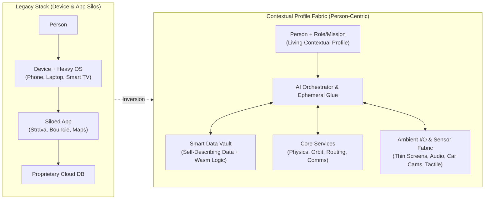
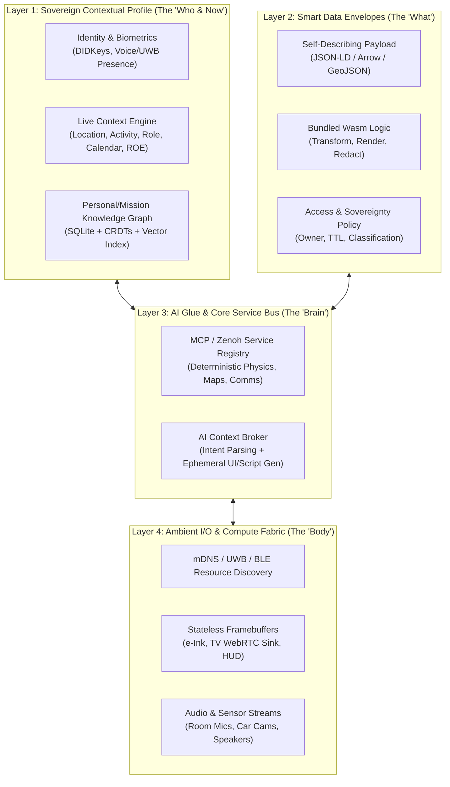
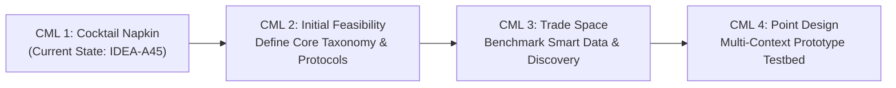

<!--
unit: UOW-A04
summary: "Inverting computing from Device->App->Data to Person->Context->(Smart Data + Ambient I/O + AI Glue) is highly viable Today as an overlay orchestration fabric using MCP, Local-First CRDTs, Wasm, and thin ESP32/Web endpoints, though commercial API walled gardens and RF boundary ambiguity remain the primary friction points."
verdict: proceed
scores:
  novel: 4
  works: 4
-->

# Holistic Concept & Feasibility Assessment: Contextual Profiles (IDEA-A45)

## Executive Summary

**Contextual Profiles** proposes a fundamental inversion of the computing stack. Today's paradigm is hardware- and vendor-siloed: `Person ↔ Device ↔ OS ↔ App ↔ Proprietary Data Silo`. This architecture causes dumb Bluetooth hijacking (`FRI-A53`), fragmented single-purpose apps for basic spatial/family awareness (`FRI-A56`), massive hardware duplication across work/personal boundaries (`FRI-A58`), full-OS bloat on simple display endpoints (`FRI-A55`), loss of personal data sovereignty (`FRI-A54`, `FRI-A57`), and rigid platform/INT stovepipes in defense C2 (`FRI-A59`).

Your proposed paradigm centers on the **Human (and their current Context)**:
$$\text{Person + Context} \longleftrightarrow \{ \text{Self-Describing Smart Data} \longleftrightarrow \text{AI Glue & Core Services} \longleftrightarrow \text{Ambient I/O & Compute Fabric} \}$$

While replacing the global consumer app economy head-on faces massive economic resistance (walled gardens profit from attention capture and data lock-in), **building a personal, business, and tactical "Contextual Fabric Overlay" is newly feasible right now**. Three recent technological shifts make this possible for a solo tinkerer:
1. **LLMs as Real-Time Glue & Ephemeral UI Generators**: Code is no longer a static artifact bought in an app store (`ART-A02`). AI agents using protocols like **MCP (Model Context Protocol)** can dynamically discover raw data sources, call deterministic physics/core services, and synthesize ephemeral UIs or scripts on the fly.
2. **Portable Sandboxed Compute (WebAssembly / WASI)**: Enables **"Smart Data"**—bundling raw data with its own lightweight, architecture-independent processing logic and access policies in a single portable envelope.
3. **Commodity Thin I/O & Spatial Sensing**: Sub-\$20 microcontrollers (ESP32-S3, e-Ink plates) and Ultra-Wideband (UWB) / BLE Angle-of-Arrival (AoA) tags allow screens, speakers, and sensors to act as stateless network-addressable I/O sinks without running a full Linux/Android OS.

---

## Detailed Analysis & Findings

### 1. Concept Synthesis & Core Value

The notes across `IDEA-A45` and `ART-A02` (`contextual-computing.md`) converge on **four structural inversions**:

| Pillar | Legacy Paradigm | Contextual Profile Paradigm | Addressed Frictions & Questions |
| :--- | :--- | :--- | :--- |
| **1. Identity & State** | Tied to device logins & corporate ad profiles | **Sovereign Contextual Profile**: Portable user state, preferences, relationships, and current activity/mission | `FRI-A53`, `FRI-A57`, `FRI-A58`, `QUE-A22`, `QUE-A25` |
| **2. Software & Logic** | Pre-installed static apps from trusted stores | **Just-in-Time AI Glue + Core M2M Services**: AI generates ephemeral views/workflows bridging deterministic services | `FRI-A54`, `FRI-A56`, `ART-A02`, `QUE-A27`, `QUE-A30` |
| **3. Data Architecture** | Passive rows trapped behind app APIs | **Smart Data Envelopes**: Self-describing data bundled with schema, provenance, RBAC/ROE, and portable transform logic | `FRI-A54`, `FRI-A59`, `QUE-A26`, `QUE-A28` |
| **4. Hardware & I/O** | Monolithic devices running full OS stacks | **Decomposed Ambient Resources**: Stateless displays, speakers, cameras, and compute discovered by proximity/intent | `FRI-A53`, `FRI-A55`, `QUE-A23`, `QUE-A24`, `QUE-A29` |

#### Unifying the Three Domains (Personal, Business, Defense)
* **Personal / Home**: Walking into the kitchen or car shifts active I/O routing. Asking *"Where is everyone today and how was my ride?"* pulls GPS tracks from Bouncie, Google Location Sharing, and Strava into a single ephemeral map rendered on the nearest screen (`FRI-A56`), or pushes a modified cayenne recipe to a dumb kitchen e-Ink framebuffer (`ART-A02`).
* **Enterprise / Green Compute**: A single workstation or tablet dynamically mounts either a cryptographically isolated "Work Profile" or "Personal Profile" from your personal fabric node, cutting hardware duplication (`FRI-A58`).
* **Defense / Warfighter C2**: Eliminates platform/INT stovepipes (`FRI-A59`). When an operator enters a Humvee or command post, their role/mission profile subscribes to relevant Blue/Red force tracks, ABI/OBP intel, and deterministic orbital/ballistic services—rendering mission-specific awareness onto vehicle displays without pre-loading heavy C2 software suites.

---

### 2. Technical & Physical Feasibility

#### What is Straightforward Today (Off-the-Shelf)
* **Dynamic Tool & Service Discovery**: Anthropic's **Model Context Protocol (MCP)**, OpenAPI, and gRPC reflection already allow an LLM agent to inspect available data sources, sensors, and deterministic calculation engines (e.g., SGP4 satellite propagation via `skyfield`) and write glue code in real time.
* **Stateless Thin Display Endpoints**: An **ESP32-S3** driving an e-Ink display (e.g., **Soldered Inkplate 6** or **Waveshare 7.5" e-Paper**) or an HDMI micro-sink (Raspberry Pi Zero 2W running a bare framebuffer/Wayland kiosk or WebRTC receiver) costs \$15–\$60, boots in <2 seconds, runs no general-purpose apps, and accepts raw buffers or declarative UI payloads (LVGL / HTML-over-WebSocket) over mDNS.
* **Local-First Sync & User-Owned Data Stores**: **CRDTs** (Conflict-free Replicated Data Types like **Automerge** or **Yjs**), **SQLite** (with LiteFS/cr-sqlite), and W3C **Solid Pods** provide mature foundations for user-owned, offline-capable data graphs.
* **Portable "Smart Data" Execution**: **WebAssembly (Wasm)** with the **WASI Component Model** (via `wasmtime` or `extism`) lets you package a data payload (e.g., Parquet/JSON-LD) alongside a compiled `.wasm` binary that knows how to validate, filter, or render that data on any CPU architecture inside a microsecond-startup capability sandbox.

#### Real Engineering Bottlenecks, Physics Constraints & Snags
1. **The "Wall-Penetrating RF" Physics Problem (Proximity != Intent)**
   * *The Snag*: Bluetooth RSSI fluctuates wildly (\(\pm 10\text{ dBm}\)) due to human body shadowing and multipath reflections. Relying on BLE signal strength alone causes the exact car/headphone hijacking that frustrates you (`FRI-A53`).
   * *The Fix*: Requires **UWB (Ultra-Wideband, IEEE 802.15.4z)** time-of-flight ranging (e.g., Apple U1/U2, Qorvo DW3000, NXP Trimension) for \(\pm 10\text{ cm}\) spatial accuracy + directional AoA, combined with **human activity state** (e.g., device accelerometer, gaze/voice wake, or NFC/mmWave presence radar like the \$5 **LD2410** 24GHz sensor) to distinguish *"walking past the driveway"* from *"sitting in the driver's seat."*
2. **Walled-Garden API Hostility (`FRI-A54`, `FRI-A56`)**
   * *The Snag*: Apple, Google, YouTube, and consumer IoT vendors intentionally restrict raw stream access and background location APIs to protect ad/subscription moats.
   * *The Fix*: Your architecture must include an **"Ingest Adapter / Scraper Layer"** (using webhook bridges, OAuth tokens where available like Strava/Bouncie APIs, Home Assistant bridges, or headless browser agents) that normalizes hostile external silos into your sovereign Contextual Profile store.
3. **LLM Latency vs. Deterministic Real-Time Loops**
   * *The Snag*: You cannot wait 3 seconds for an LLM to route audio packets or overlay a car turn arrow onto a 60fps camera feed.
   * *The Fix*: **Control Plane vs. Data Plane separation**. The AI acts strictly in the *Control Plane*—negotiating schemas, writing the glue pipeline, and binding endpoints (takes 1–3s once when context changes). Once bound, the *Data Plane* streams directly peer-to-peer (RTP/WebRTC/Zenoh/MQTT) at sub-10ms hardware speeds.
4. **"Thin I/O" Still Needs Zero-Trust Cryptographic Binding**
   * *The Snag*: If a kitchen screen or Humvee display has "no OS" and accepts pushed content via discovery, any rogue actor in RF range could push spoofed intel or malicious payloads (`FRI-A55`).
   * *The Fix*: Every thin I/O endpoint still needs a lightweight hardware root of trust (e.g., ESP32-S3 HMAC/Secure Boot + **Noise Protocol Framework** or **mTLS** session keys) tied to the user's Contextual Profile public key (DID / passkey).
5. **Defense Cross-Domain / MLS (Multi-Level Security) Barriers (`FRI-A59`)**
   * *The Snag*: In tactical environments, dynamically mixing TS/SCI intel with Secret C2 tracks on an arbitrary vehicle terminal triggers strict NSA/DoD Cross-Domain Solution (CDS) accreditation walls.
   * *The Fix*: "Smart Data" envelopes must carry cryptographically signed **STANAG 4774/4778 confidentiality metadata labels** and policy-enforcement Wasm guards that automatically redact or downgrade fields before rendering on lower-clearance I/O nodes.

#### Prior Art & Existing Building Blocks to Leverage
* **Plan 9 from Bell Labs (9P Protocol)**: Pioneered decomposing compute, storage, and I/O (screens, mice, audio) into network-mounted file descriptors so any process can use any hardware resource on the network.
* **Dynamicland (Bret Victor / RealTalk)**: Replaced apps and personal devices with an ambient physical room where tables, projectors, and cameras act as a shared contextual compute fabric.
* **Eclipse Zenoh / Named Data Networking (NDN)**: Next-gen pub/sub/query protocols designed for IoT and tactical edge where nodes request *named data by context* rather than connecting to fixed IP addresses.

---

### 3. Decomposition & Architecture Angles

To make this tractable, we decompose the concept into **four decoupled layers**:

#### Three Architectural Topologies (Trade Space)
1. **Option A: Personal Anchor Hub ("Body-Area Orchestrator")**
   * Your phone or a headless wearable puck holds your Contextual Profile, runs local AI routing, and pushes UI/audio streams to dumb room/car endpoints.
   * *Pros*: Maximum privacy, works offline/off-grid (tactical/backcountry), zero reliance on room infrastructure.
   * *Cons*: Limited by portable battery/compute.
2. **Option B: Ambient Room/Vehicle Broker ("Smart Environment")**
   * The environment (Home Server, Car Compute Module, Tactical Edge Server) senses occupants via UWB/biometrics, pulls their encrypted Contextual Profile shards, and orchestrates local I/O.
   * *Pros*: Handles multi-person contexts naturally (e.g., *4 guys in a car* example), heavy local GPU compute, camera fusion (Mini Cooper AR navigation).
   * *Cons*: Requires trusted environmental compute.
3. **Option C: Hybrid Federated Fabric (Recommended)**
   * The user carries an **Anchor Token/Device** (phone or UWB/crypto wearable) that holds cryptographic keys and core profile state, which dynamically **leases** ambient compute and I/O from trusted environments (Home, Car, Humvee) via ephemeral encrypted sessions.

#### Minimum Viable Tinkering Slice (MVTS) vs. Full Vision
* **Full Vision**: OS-less world with universal smart data, biometric multi-user car/room handoff, zero apps, and tactical CDS certification.
* **Minimum Viable Tinkering Slice (Buildable in 1–2 Weekends for <\$100)**:
  * **1 Contextual Profile Daemon** (Python/TypeScript + SQLite/DuckDB + MCP Server running on your Tinkerspace workstation or laptop).
  * **3 Live Data/Service Connectors**: Unified Geo Service (pulling Bouncie API + Strava API + Google Location/GPX), Personal Recipe/Notes Vault, and a deterministic Defense/Space service (`skyfield` satellite pass calculator).
  * **2 Stateless Thin I/O Endpoints**:
    1. A simulated or physical **ESP32 e-Ink Kitchen Display** exposing a single network tool: `render_canvas(markdown_or_image)`.
    2. A **Browser/Tablet "Zero-App Surface"** that receives dynamically synthesized HTML/Mapbox/Canvas views over WebSocket whenever your context shifts or you speak a request.

---

### 4. Review of Open Questions & Unknowns

#### Direct Answers to Linked QuestionStorm Questions

* **`[QUE-A22]` How can digital architecture center on a person's living contextual profile rather than apps and devices?**
  * **Answer**: Replace app-specific databases with a **Personal Context Graph** (stored locally in SQLite/CRDTs) paired with an **MCP Context Broker**. Instead of opening an app, your profile broadcasts an active *Context Vector* `(Identity, Location, Current Activity, Available I/O)` to an AI orchestrator, which queries raw data/services and renders an ephemeral view tailored to the available screen/speaker.
* **`[QUE-A23]` Can hardware screens, compute, and speakers be decomposed into dynamic, discoverable ambient resources?**
  * **Answer**: **Yes.** Using mDNS/DNS-SD or Eclipse Zenoh for zero-config local discovery, every screen, speaker, and sensor advertises a capability descriptor (e.g., `type: display, res: 800x480, color: 1bit-eink, protocol: lvgl-stream`). The AI orchestrator treats hardware peripherals simply as callable output sinks.
* **`[QUE-A24]` Is ambient resource discovery decentralized across resources or coordinated by an anchor device?**
  * **Answer**: **Hybrid (Discovery is decentralized; Authorization & Session Routing are coordinated by the Person's Anchor).** Ambient devices beacon their capabilities locally (BLE/mDNS/UWB), while the user's personal anchor (phone/wearable/keycard) holds the private keys that authorize and bind those resources into a temporary personal session.
* **`[QUE-A25]` Can a single physical device securely isolate work and personal contextual profiles to eliminate hardware duplication?**
  * **Answer**: **Yes.** Hardware-enforced virtualization—such as **Type-1 hypervisors** (Qubes OS / Xen), **Linux namespaces/cgroups + microVMs** (Firecracker), or **USB-C/network bootable immutable profile containers**—allows any commodity laptop/tablet to act as a "stateless iron terminal" that mounts either your encrypted Work Profile or Personal Profile with zero cross-contamination.
* **`[QUE-A26]` Can data bundle its own processing logic and self-describing context so it travels to where it is needed?**
  * **Answer**: **Yes, via "Smart Data Envelopes" (Data + JSON-LD Schema + WebAssembly).** By packaging data payloads alongside a compiled `.wasm` module (WASI), the data carries its own parser, visualization renderer, and access-control logic that executes safely in a sandbox on any target device without pre-installing apps.
* **`[QUE-A27]` Does an application provider need to own or gatekeep the content and data it renders?**
  * **Answer**: **Technically no; economically they do so only to extract rent.** In a decoupled architecture, *Content/Data Providers* expose paid/free machine-to-machine streams, *Core Compute Services* expose APIs (routing, physics), and *Rendering* happens locally via your AI glue—mirroring how SMTP (email) or RSS works without a single app owner.
* **`[QUE-A28]` Who funds and maintains open data infrastructure if content is unbundled from proprietary monetization apps?**
  * **Answer**: Three viable models replace ad-driven app silos:
    1. **User-Paid Personal Cloud / Local Hardware**: You own your storage/compute (NAS, \$5/mo VPS, home server).
    2. **Micropayment / API Metered Services**: Content creators and heavy-lifting services (weather, satellite imagery, traffic) charge per-API-call or subscription via machine-to-machine tokens (e.g., Stripe metered billing, L402 protocol) rather than bundling a bloated UI app.
    3. **Enterprise / Defense Mission Funding**: In B2B and DoD (`FRI-A59`), the organization already pays for the sensors, compute, and network—eliminating stovepipes is a pure cost and lethality win.
* **`[QUE-A29]` How can contextual profiles deliver dynamic mission awareness to warfighters without pre-configured platforms?**
  * **Answer**: Combine **Role/Mission Context Profiles** with **Pub/Sub Named Data (Zenoh/TAK)**. When a warfighter enters a vehicle or TOC, their cryptographic token asserts their Role, Assigned Mission, and Geospatial Area of Interest (AOI). The local node automatically subscribes to matching track/intel topics and executes the Smart Data's bundled Wasm rendering/ROE logic on the vehicle's generic displays.
* **`[QUE-A30]` Can AI act as an autonomous peer role within the contextual profile ecosystem rather than an external driver?**
  * **Answer**: **Yes.** Give each AI agent its own **Contextual Profile** (with defined role, objectives, permissions, and subscribed data streams). Just like a human intel analyst or wingman, the AI peer receives relevant state changes automatically, runs background sensemaking, and publishes derived Smart Data back into the shared fabric.

#### Critical Unasked Questions & Hidden Assumptions
1. **The "Failure / Determinism" Question**: *When the AI dynamically generates glue code or fuses a unified map, how does the user trust that a missing pin isn't a silent script bug (especially for family safety or warfighter C2)?* -> Requires separating **verified schema adapters** from **AI layout composition**.
2. **Multi-User Conflict Resolution**: *When 4 guys are in the car or a family is in the living room, whose Contextual Profile wins the shared speaker vs. the private screen, and what prevents private notifications from leaking onto shared ambient displays?* -> Needs an explicit **Privacy & Arbitration Tier** (`Private Wearable` vs. `Semi-Public Car/Family` vs. `Public Guest`).

---

## Recommendations & Next Steps (JPL CML Maturation Strategy)

Your Tinkerspace workflow advances ideas one JPL Concept Maturity Level (CML) at a time. Currently, `IDEA-A45` is at **CML 1 (Cocktail Napkin / Initial Vision)**. Below is the recommended step-by-step maturation roadmap to reach **CML 4 (Point Design & Breadboard Validation)**:

### Phase 1: CML 1 → CML 2 (Initial Feasibility & Bounding the Concept)
* **Objective**: Establish mathematical/architectural feasibility and lock down the core ontology so "Contextual Profile" and "Smart Data" have concrete software schemas rather than philosophical definitions.
* **Proposed CML 2 Work Units**:
  1. **Schema & Ontology Specification (`Contextual Profile` + `Smart Data Envelope`)**: Define the exact JSON-LD / SQLite schema for a Contextual Profile (Identity, Location, Activity, Active I/O, Privacy Tier, Role/Mission) and the specification for a Wasm-backed Smart Data Envelope.
  2. **Control Plane vs. Data Plane Protocol Sizing**: Desk-check latency, bandwidth, and discovery handshake budgets for binding ambient I/O (e-Ink, audio, tactical map) using MCP + Zenoh/WebSockets.

### Phase 2: CML 2 → CML 3 (Trade Space Exploration & Subsystem Bench Checks)
* **Objective**: Explore architectural trade-offs and run quick, decisive bench experiments on the three riskiest technical unknowns.
* **Proposed CML 3 Work Units**:
  1. **Experiment A — "Zero-App Unified Geo & Recipe Surface" (Personal + Business Slice)**: Build a lightweight local daemon that ingests simulated/live Bouncie + Strava + Family GPS tracks and recipe notes, dynamically synthesizes an ephemeral unified map and kitchen e-Ink payload via AI glue, and measures end-to-end latency.
  2. **Experiment B — "Smart Data Envelope" Bench Test (Defense C2 Slice)**: Package a tactical dataset (e.g., Red/Blue tracks + satellite pass data) inside a single portable container with a compiled Wasm policy/rendering module; verify that an unconfigured host can execute and render the data according to two different Warfighter Role Profiles (e.g., *JTAC* vs. *Space Ops*).
  3. **Experiment C — Proximity & Context Handoff Trade Study**: Compare BLE RSSI vs. UWB / mmWave presence + activity state for solving the "4 guys in a car / sleeping laptop Bluetooth hijack" (`FRI-A53`) without false handoffs.

### Phase 3: CML 3 → CML 4 (Point Design & Integrated Prototype)
* **Objective**: Converge on a single baseline **Contextual Computing Reference Architecture** with working hardware-in-the-loop (1 workstation/car screen + 1 ESP32 e-Ink display + 1 mobile/tactical profile switch) and cost/LOC bill of materials.
